<!--
  Every visual below lives in /assets and is generated by design/build.py
  (dark + light variants — GitHub swaps them through <picture>).
  Edit copy/projects in design/build.py → run `python3 design/build.py` → commit.
-->

  <picture>
    <source media="(prefers-color-scheme: dark)" srcset="assets/hero-dark.svg">
    
  </picture>

<picture>
  <source media="(prefers-color-scheme: dark)" srcset="assets/h-about-dark.svg">
  
</picture>

  <picture>
    <source media="(prefers-color-scheme: dark)" srcset="assets/about-dark.svg">
    
  </picture>

- 🎓 **Programming Instructor @ [10x Academy](https://10x.edu.ge/) (Tenixi)** — teaching JavaScript & React. *"For every concept taught, I explore tenfold."*
- 🎨 Designed and built **[Artisser](https://www.artisser.io/)** and **[FixMob](https://www.fixmob.ge/)** end to end — from visual design to frontend
- ⚽ Building **[SportGen](https://sportgen.org/)** — a multi-sport SaaS ecosystem of 8 apps, starting with Georgian football
- 🧩 Design included — every platform ships with in-house UI/UX, its own admin panel and a management engine behind it
- 🛢️ Before software: 6 years as an operator at **Batumi Oil Terminal** (2020–2026) — complex systems where failure is not an option. That discipline came with me.

<picture>
  <source media="(prefers-color-scheme: dark)" srcset="assets/h-work-dark.svg">
  
</picture>

  <a href="https://sportgen.org/"><picture><source media="(prefers-color-scheme: dark)" srcset="assets/card-sportgen-dark.svg"></picture></a>

  <a href="https://www.artisser.io/"><picture><source media="(prefers-color-scheme: dark)" srcset="assets/card-artisser-dark.svg">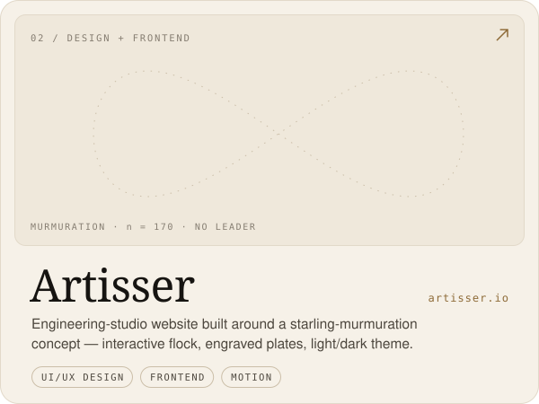</picture></a>
  <a href="https://www.fixmob.ge/"><picture><source media="(prefers-color-scheme: dark)" srcset="assets/card-fixmob-dark.svg"></picture></a>

  <a href="https://dental-clinic-densi.vercel.app/"><picture><source media="(prefers-color-scheme: dark)" srcset="assets/card-densi-dark.svg">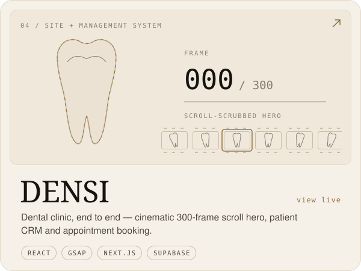</picture></a>
  <a href="https://fitfactory-webgrandpas-projects.vercel.app/ka"><picture><source media="(prefers-color-scheme: dark)" srcset="assets/card-fitfactory-dark.svg"></picture></a>

  <a href="https://fincotime.vercel.app/"><picture><source media="(prefers-color-scheme: dark)" srcset="assets/mini-fincotime-dark.svg">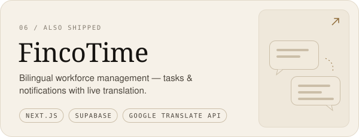</picture></a>
  <a href="https://play.google.com/store/apps/details?id=com.giorgikhiladze.overtapme&hl=en"><picture><source media="(prefers-color-scheme: dark)" srcset="assets/mini-overtap-dark.svg">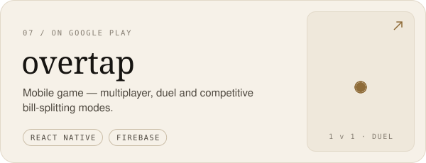</picture></a>

<b>🚧 In progress</b> — Booking SaaS · lifeOS · OTP Gateway

 

| Project | What it is | Built with |
|:--|:--|:--|
| **Booking SaaS** | Multi-tenant booking engine — standalone availability core, embeddable widget (script-tag → iframe → postMessage), DB-level double-booking prevention. Built with a team of three. | `TypeScript` `PostgreSQL` `RLS` |
| **lifeOS · Task Tracker** | Personal life system + habit tracker with flexible repeat intervals, styled in neobrutalism / neumorphism. | `React Native` `Firebase` |
| **OTP Gateway** | Self-hosted SMS gateway on a spare Android phone — OTP verification without paid SMS APIs. | `Node.js` `Android` |

<picture>
  <source media="(prefers-color-scheme: dark)" srcset="assets/h-how-dark.svg">
  
</picture>

<picture>
  <source media="(prefers-color-scheme: dark)" srcset="assets/how-dark.svg">
  
</picture>

<picture>
  <source media="(prefers-color-scheme: dark)" srcset="assets/h-toolkit-dark.svg">
  
</picture>

<picture>
  <source media="(prefers-color-scheme: dark)" srcset="assets/toolkit-dark.svg">
  
</picture>

<picture>
  <source media="(prefers-color-scheme: dark)" srcset="assets/h-path-dark.svg">
  
</picture>

<picture>
  <source media="(prefers-color-scheme: dark)" srcset="assets/path-dark.svg">
  
</picture>

<picture>
  <source media="(prefers-color-scheme: dark)" srcset="assets/h-signal-dark.svg">
  
</picture>

  <picture>
    <source media="(prefers-color-scheme: dark)" srcset="https://github-readme-stats-eight-theta.vercel.app/api?username=webGrandpa&include_all_commits=true&count_private=true&show_icons=true&hide_border=false&border_radius=14&bg_color=0d0d0c&border_color=25221e&title_color=C9A878&icon_color=C9A878&ring_color=C9A878&text_color=B4AB9D">
    
  </picture>
  <picture>
    <source media="(prefers-color-scheme: dark)" srcset="https://github-readme-stats-eight-theta.vercel.app/api/top-langs/?username=webGrandpa&include_all_commits=true&count_private=true&layout=compact&langs_count=8&hide_border=false&border_radius=14&bg_color=0d0d0c&border_color=25221e&title_color=C9A878&text_color=B4AB9D">
    
  </picture>

<picture>
  <source media="(prefers-color-scheme: dark)" srcset="assets/h-contact-dark.svg">
  
</picture>

  <a href="https://www.linkedin.com/in/giorgi-khiladze-55bab334a/"><picture><source media="(prefers-color-scheme: dark)" srcset="assets/btn-linkedin-dark.svg"></picture></a>
  <a href="https://instagram.com/goga.khilo"><picture><source media="(prefers-color-scheme: dark)" srcset="assets/btn-instagram-dark.svg"></picture></a>
  <a href="mailto:goga.khilo@gmail.com"><picture><source media="(prefers-color-scheme: dark)" srcset="assets/btn-email-dark.svg"></picture></a>

<picture>
  <source media="(prefers-color-scheme: dark)" srcset="assets/footer-dark.svg">
  
</picture>
